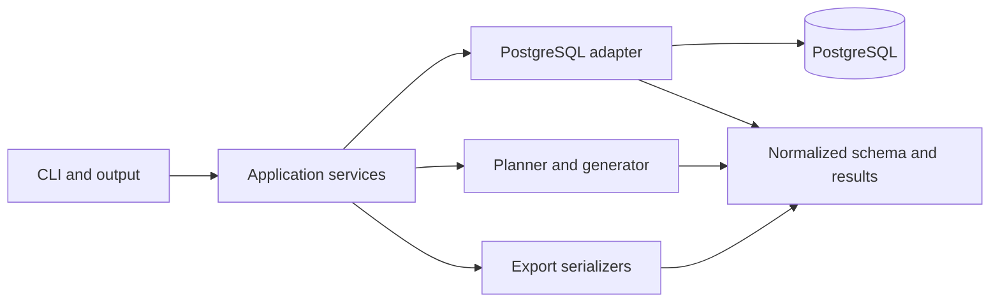

# Architecture

Seed is a single Python CLI. Application services coordinate inspection, planning, and generation. The core uses typed models independently of the terminal, database driver, and filesystem.

## Execution flow

| Step | Responsibility |
|---|---|
| Inspect | Reflect the selected schema with SQLAlchemy Core inside a read-only snapshot. Supplement reflection with PostgreSQL catalogs for keys, indexes, checks, identities, generated columns, triggers, rules, and row policies. Normalize and classify the [metadata](DATA_MODEL.md#postgresql-support). |
| Plan | Resolve exact names and counts, expand parents for tables producing rows, and topologically sort with qualified names as tie-breakers. Treat read-only reused parents as terminal dependencies. Report cycles, unsupported edges, and compatibility by execution mode. |
| Generate | Produce ordered, validated batches. The consumer receives records and supplies returned live IDs or approved existing parent tuples. Keep SQLAlchemy types and driver exceptions inside the adapter. |
| Consume | Preview and validate offline, export to a fresh directory, or apply in one locked transaction. Follow the [security contract](SECURITY.md) for the write and export boundaries. |
| Report | Application services return typed results and redacted issues. The CLI maps them to terminal output, JSON, and documented exit statuses. |

## Generation

`seed.generation.engine.generate_batches` is the internal offline entry point. It takes the typed plan, the matching schema snapshot, and the loaded config containing generator rules. Each batch belongs to one table. The engine keeps table-local ordinals for consumers and performs no database or filesystem operations. Preview and dataset validation use this engine.

1. Bind managed columns to foreign keys, explicit offline IDs, live server identities, or omission for computed columns. For the remaining columns, apply explicit rules within schema bounds, infer compatible column-name semantics, then fall back to the type generator. Reject incompatible explicit rules and unsupported writable columns.
2. Each generator receives a typed column binding, row ordinal, private RNG, Faker locale, and reference time. It returns a typed scalar or a scoped issue. Normalize precision and check values before reserving unique tuples or emitting a batch.
3. Use SHA-256-derived streams keyed by the seed, qualified table, binding, and algorithm version. Seed local RNG and Faker instances, derive UUIDs from controlled bits, and generate dates within the 365 days ending at the configured reference time. Keep draws independent of batch boundaries. Generator versions, server-computed values, and relevant existing state affect reproducibility.
4. Build parent pools from non-null key tuples, in constraint-column order. A child copies a tuple intact, or emits all nulls if every FK member is nullable and the null draw succeeds. Partly nullable composites use complete tuples. An empty pool blocks a positive-row edge unless the eligible edge is always null.
5. Allocate offline identity IDs as ascending integers from `1`. Live apply omits server-owned identities and uses ordered `RETURNING` correlation, falling back to single-row inserts if needed. Check local uniqueness, including each constraint’s null semantics. Use bounded indexed probes for supported keys when appending. One-to-one FKs reserve parent keys without replacement where needed.
6. Stream the current batch and retain needed key and uniqueness state only. Limit a plan to 100,000 generated rows, a batch to 10,000, each existing parent pool to 10,000 distinct tuples, candidates to 100 attempts per row, and reported generation issues to 100 plus a truncation warning. Fail early on proven exhaustion.

| Inferred names | Generator behavior |
|---|---|
| `email`, `email_address` | `email` uses a synthetic local part with a varied suffix and an `example.com` domain. |
| `phone`, `phone_number` | `phone` uses a documented fictional range, such as `+1-202-555-01xx` for `en_US`. Inference can fall back to generic text when a locale has no safe provider. |
| `first_name`, `last_name`, `name`, `address`, `city`, `country`, `description` | Use Faker providers of the same names when compatible. |
| `price`, `amount`, `quantity`, `created_at`, `updated_at`, `is_active`, `status`, `uuid` | Use compatible numeric, datetime, boolean, declared enum or configured choice, and UUID generators. |

## Stack and layout

Seed uses CPython 3.12+, Typer and Rich for the CLI, Pydantic and `tomllib` for configuration, SQLAlchemy Core and Psycopg for PostgreSQL, and Faker for generation. The [development guide](DEVELOPMENT.md) covers tooling and supported platforms.

In `src/seed/`, start with `cli.py` for CLI wiring, `config.py` for configuration, and `metadata.py` for shared schema models.

| Package | Responsibility |
|---|---|
| `workflows/` | Configure and coordinate commands such as apply, export, preview, and validate. |
| `postgres/` | Connect, inspect schema and catalogs, guard apply targets, and insert batches. |
| `planning/` | Select tables, order dependencies, and choose column bindings. |
| `generation/` | Generate batches, draw typed values, and enforce constraints and relationships. |
| `reporting/` | Format inspection and plan results and project typed dataset values. |
| `exporting/` | Serialize SQL, CSV, and JSON and publish files and manifests. |

## Decisions

These decisions describe the project architecture and distribution. Each row records the reason for the choice, the main alternative, and its consequence.

| ID | Decision | Why, alternative, and consequence |
|---|---|---|
| ADR-001 | Python over Go | Mature schema and Faker tooling outweigh single-binary delivery. Test interpreter and driver installs. |
| ADR-002 | PostgreSQL first | Engine-specific constraints merit one supported backend before adding SQLite or MySQL. |
| ADR-003 | SQLAlchemy Core | Framework-independent reflection and binds reduce hand-written SQL. Supplement catalog coverage and keep ORM models out of the core. |
| ADR-004 | Psycopg 3 | Typed adaptation, `RETURNING`, and SQL composition support live and export modes. Verify correlation and platform wheels. |
| ADR-005 | Local Faker providers | Seeded providers replace hosted generation and general-purpose custom factories. Provider upgrades can change output. |
| ADR-006 | Versioned TOML | Declarative files and strict validation suit repeatable projects. Breaking config changes require a version and upgrade guide. |
| ADR-007 | Modular monolith | Shared workflows fit one process and package. Defer hosted components and plugin frameworks. |
| ADR-008 | Local-first execution | One configured database connection and local output keep credentials and datasets under user control. |
| ADR-009 | Deterministic streams | Private seeded RNGs and fixed time support reproducibility across batches. Record relevant versions and state. |
| ADR-010 | One apply transaction | Commit-per-batch could leave an incomplete dataset. Longer transactions hold locks and can leave sequence gaps on failure. |
| ADR-011 | Guarded append | Empty targets are the default. Opt-in append and key reuse require bounded probes and depend on existing state. |
| ADR-012 | Reject cycles and self references | Staged writes or selective deferral add complexity. Parent-first generation covers the supported graph. |
| ADR-013 | Explicit target checks | Host, port, database, schema, and environment checks provide stronger evidence than naming heuristics. See the [deployment limits](SECURITY.md#threat-model). |
| ADR-014 | Strict target locking | Table locks protect the empty-table check from other writers. Advisory locks would only coordinate Seed. Scoped grants and contention are tradeoffs. |
| ADR-015 | Explicit offline identities | Concrete IDs preserve exported relationships. A matching empty schema and sequence reconciliation are required for import. |
| ADR-016 | Composite tuples and simple checks | Support common junctions and numeric bounds. Block constraints outside the [support matrix](DATA_MODEL.md#postgresql-support). |
| [ADR-017](RELEASE.md#naming-licence-and-versions) | Release identity and licence | Publish as `seed-dev-db` on PyPI while keeping the `seed` executable and Python import. Use `KiraQiez/tap/seed` and Apache-2.0 with copyright 2026 KiraQiez. |
